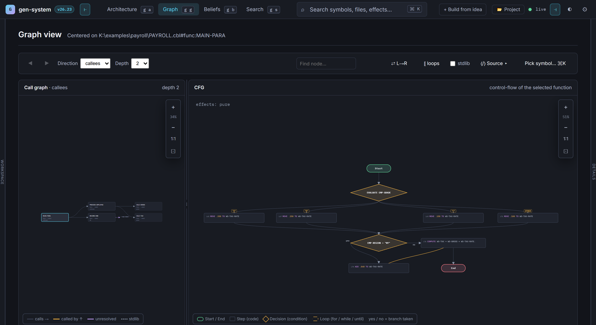
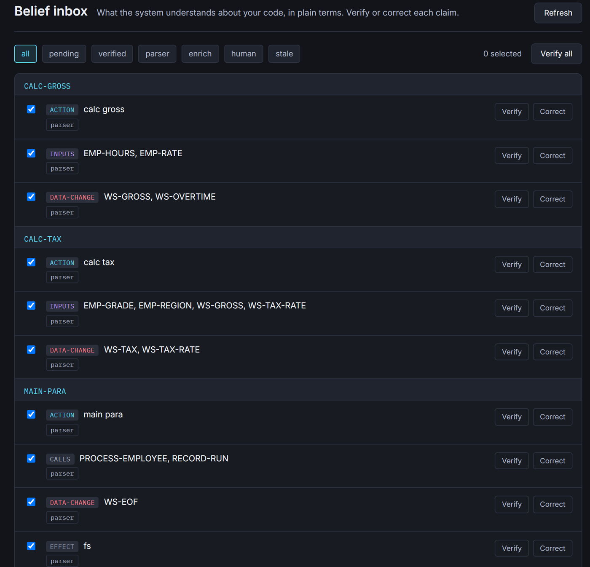
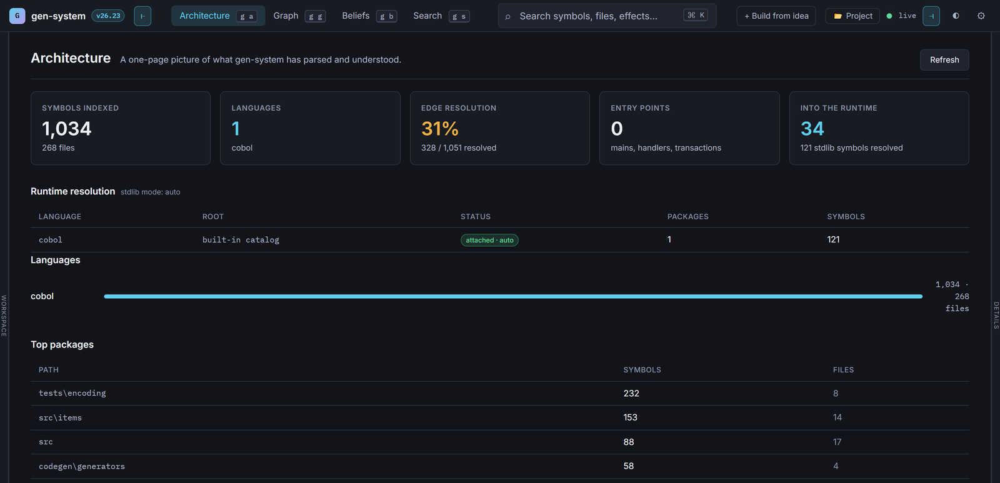
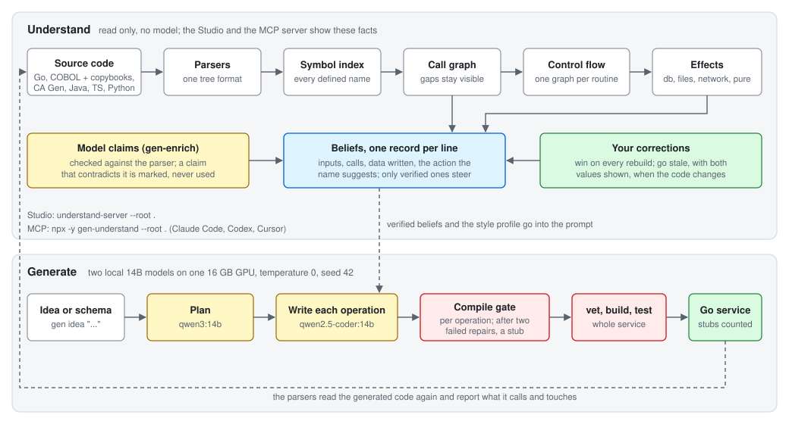

<h1 align="center">gen-system</h1>

<p align="center"><strong>Parser facts about a codebase, and Go services from local models that must compile before they ship.</strong></p>

<p align="center">
  <a href="LICENSE"></a>
  <a href="go.mod"></a>
  <a href="https://www.npmjs.com/package/gen-understand"></a>
  <a href="https://registry.modelcontextprotocol.io/v0/servers?search=gen-understand"></a>
  <a href="docs/understand-pipeline.md#the-six-parsers"></a>
</p>



*The Studio on [`examples/payroll`](examples/payroll). Left: what `MAIN-PARA` calls, two levels
deep. Right: the control flow graph of `CALC-TAX`. The `EVALUATE` on the pay grade fans out into
four arms, then the region check adds a branch.*

A model that writes code for an existing system has to guess about it. What does this routine
call? Which data does it write? What does a COBOL paragraph pull in from a copybook? gen-system
answers those questions with parsers, one hand written parser each for Go, COBOL with copybooks,
CA Gen, Java, TypeScript and Python. They build the syntax tree, the symbol index, the call graph
and the control flow graph of each routine. No model takes part in that step, so the same code
always gives the same graph.

For each routine, gen-system then lists the inputs, the calls, the data it writes and the action
its name suggests. It calls each line a belief. A local model may add claims, and gen-system marks
any claim the parser contradicts and never uses it. You can correct any belief. Only beliefs a
person verified steer generation.



*The Beliefs page for `examples/payroll`. A COBOL paragraph has no parameters, so gen-system reads
its inputs and the data it writes from its statements: `CALC-TAX` reads the grade, the region, the
gross pay and the rate, and writes the tax and the rate. Each line has Verify and Correct.*

The generation half plans a Go service with `qwen3:14b` and writes each operation with
`qwen2.5-coder:14b`. Each operation must compile on its own before it enters the service file. A
body that still fails after two repairs becomes a `not implemented` stub, and the run counts it.
Then `go vet`, `go build` and `go test` run on the whole service, and the parsers read the result
again.

I measured the parsers on 2026-09-09, on four public repositories pinned to a commit: 405 files,
268 of them COBOL. They hit 0 parse errors and resolved 100% of the calls between each project's
own symbols. They built 1,302 control flow graphs, and none had an issue. On 60 SWE-bench Verified
tasks, gen-system took the names in each issue and walked two hops through the call graph. The
walk reached 0.674 of the files the real fix touched, and a median of 422 files per task. That
is localization recall, not a solve rate: gen-system writes no fix. The raw files are in
`results/2026-09-09/`.

## What you get

| Program | What it does |
|---|---|
| `understand-server` | the Studio in your browser: architecture, symbol search, call graph, control flow graphs, source and beliefs. Correct a belief in place. Read only, no model |
| `understand-mcp` | the same facts for Claude Code, Codex, Cursor or any MCP client |
| `gen-enrich` | asks the local model to describe each routine and stores the answers as model claims |
| `gen` | `idea` plans and generates a service; `continue` and `evolve` change one; `style` measures and checks a team style profile; `migrate` applies the database changes |
| `gen-server` | the Studio plus the generation half |
| `genbench` | the measurements: parse speed, call resolution, model speed, generation |

The read only half (`understand-server`, `understand-mcp`) links no generation code and no model
client. An architecture test (`internal/archtest`) fails the build if that changes.

## Install

You need Go 1.25 or newer. The generation half also needs [Ollama](https://ollama.com) and one GPU
with 16 GB. I run it on an RTX 4060 Ti with 16 GB, on Linux and on Windows.

```bash
git clone https://github.com/hpdkhoa/gen-system.git
cd gen-system
./install.sh                # Go, Ollama, the two models, optional Postgres and Node
./install.sh --understand   # only the read only half, for an air gapped review
```

The installer pulls the two default models:

```bash
ollama pull qwen3:14b           # plans
ollama pull qwen2.5-coder:14b   # writes code
```

`genbench model` shows whether Ollama is up, whether the model loaded and whether it stays
resident. Run it before you measure anything.

## Read a codebase

```bash
understand-server --root ./your-repo
```

Open http://localhost:28080/. gen-system writes the beliefs to `./your-repo/.gen/beliefs.json`.
Correct one in the Studio, or POST to `/api/present/beliefs/correct`. Your correction wins from
then on. If the source changes under it later, gen-system marks the belief out of date and shows
your value next to the new one.

Python files need `python3` 3.9 or newer on the host. The other five parsers are pure Go. A
construct a parser cannot model becomes an unknown node that carries the reason.

To try it before you point it at your own code, open one of the two examples:

```bash
understand-server --root examples/payroll --copybooks examples/payroll/copybooks
understand-server --root examples/shop
```



*The Architecture page for [CobolCraft](https://github.com/meyfa/CobolCraft), a Minecraft server
written in COBOL. "Edge resolution 31%" counts every call edge, including calls into the GnuCOBOL
runtime and C helpers that have no COBOL definition to resolve to. Every call between CobolCraft's
own programs resolves; the baseline in `generator/internal/bench/baselines/` explains the split.*

## Give your agent the facts (MCP)

```bash
claude mcp add gen-understand -- npx -y gen-understand --root ./your-repo
```

or, with Go and no npm:

```bash
go install github.com/hpdkhoa/gen-system/generator/cmd/understand-mcp@latest
claude mcp add gen-understand -- understand-mcp --root ./your-repo
```

| Tool | Answers |
|---|---|
| `architecture` | the languages, top packages, entry points, call resolution, and what the parsers could not model |
| `search_symbols` | symbols by name, ranked, with the ids the other tools take |
| `call_graph` | a walk over the call edges from one symbol; a callee it cannot resolve shows as an external node |
| `control_flow` | a function's basic blocks, their edges and the source lines in each block |
| `source`, `file_symbols` | the code of one symbol; every symbol in one file |
| `effects` | functions grouped by what they touch: database, files, network, pure or unknown |
| `beliefs` | the belief records with their source (parser, model or person), filtered by routine, kind or verified state |

Ask your agent "who calls CALC-TAX, and which paragraphs touch the database?" on
`examples/payroll`, and it calls two tools. These are the real answers, shortened:

```jsonc
// call_graph {"symbol": "…PAYROLL.cbl#func:CALC-TAX", "direction": "callers", "depth": 3}
"edges": [
  { "from": "…#func:PROCESS-EMPLOYEE", "to_name": "CALC-TAX",         "unresolved": false },
  { "from": "…#func:MAIN-PARA",        "to_name": "PROCESS-EMPLOYEE", "unresolved": false }
]

// effects {}
"by_effect": {
  "db":   [ { "name": "RECORD-RUN", "line": 78 } ],
  "pure": [ { "name": "CALC-GROSS", "line": 53 }, { "name": "CALC-TAX", "line": 62 } ]
}
```

`RECORD-RUN` is the only paragraph with an `EXEC SQL` block, and the parser found it without a
model.

`correct_belief` exists only when you start the server with `--allow-corrections`. The server
runs locally and sends nothing anywhere. [docs/mcp.md](docs/mcp.md) covers Codex, Cursor, the
flags and the protocol.

## Generate a service

```bash
gen idea --out ./generated-app "a library lending service with members, books and loans"
```

Every model call uses temperature 0 and seed 42. gen-system attaches the standard library of each
language in the project, so the final check knows `net/http` and `encoding/json` when it reads the
output. `--stdlib none` turns that off, and `--stdlib go,java=/opt/jdk/java.base` names the roots.

A team style profile puts your conventions into every prompt. The parsers then check the same
rules on the output:

```bash
gen style derive ~/code/team-repo --out gen-style.json   # measure a repo, with evidence per rule
gen idea --style gen-style.json --style-mode gate "a support ticket tracker"
gen style check ./generated-app/backend --profile gen-style.json
```

An operation that compiles but breaks a rule goes back to the model with the rule named. Only the
compile gate can turn an operation into a stub. [docs/style-gate.md](docs/style-gate.md) lists
what a profile can say.

## Settings

Copy `gen-system.env.example` to `.env`. A variable in your shell wins over the file.

| Variable | Meaning |
|---|---|
| `OLLAMA_HOST` | the Ollama address; default `http://127.0.0.1:11434` |
| `OLLAMA_MODEL_PLAN`, `OLLAMA_MODEL_CODE` | the planning model and the code model |
| `OLLAMA_KEEP_ALIVE` | how long Ollama keeps a model loaded between calls |
| `OLLAMA_TIMEOUT` | seconds per model call |
| `GEN_STDLIB` | the standard library roots, in the `--stdlib` form |
| `GEN_COBOL_COPYBOOK_PATH` | where the COBOL parser looks for copybooks |

## How it works



- `generator/internal/ast`: one parser per language, all into one tree format.
- `generator/internal/symbols`, `flow`: the symbol index, call resolution and control flow graphs.
- `generator/internal/belief`: the belief records, model claims, corrections and staleness.
- `generator/internal/presentation`: the API the Studio and the MCP server share.
- `generator/internal/engine`, `agent`, `planner_v2`: planning, generation and the gates.
- `generator/internal/ai`: the single path to the model.

The two models run one after the other. Ollama keeps a model loaded between calls, and swapping
between them took about 2 seconds in the 2026-09-09 run.

## Test

```bash
make test
```

It runs `go test ./...` in `generator/`. Several tests write `.gen/ast_cache` folders next to the
code they parse; run them on a copy if you want a clean tree.

## Benchmarks

`bench/` holds the harness, the task set and the drivers. I commit the task set before any run.

```bash
./bench/freeze-env.sh    # record the commit, GPU, driver and model list
./bench/run-all.sh       # the full campaign
python3 bench/attest.py --results results/<date>
```

Each campaign ends with `results/<date>/ATTESTATION.md`. It records what ran, on which commit and
machine, and which runs the harness dropped and why. `MANIFEST.sha256` lists every raw file with
its SHA-256. [bench/README.md](bench/README.md) explains each driver.

A service that compiles is a weak signal here. A body that fails the compile gate twice becomes a
stub, and stubs compile. Read the stub rate and the repair counts.

## Limitations

- One GPU. No multi GPU or multi node support.
- Six languages. Other files parse as unknown nodes, with no symbol resolution.
- Body rewriting works for Go and Python only. Other languages return a `not implemented` error.
- The model's security review warns and never blocks.
- The CLI summarizes beliefs per service only. The code for module and project summaries exists
  but does not run yet.

## Documentation

- [docs/understand-pipeline.md](docs/understand-pipeline.md): from a source file to a control flow graph.
- [docs/beliefs.md](docs/beliefs.md): the belief record, a worked example, and how staleness spreads.
- [docs/model-contact.md](docs/model-contact.md): the single path to the model and its settings.
- [docs/style-gate.md](docs/style-gate.md): style profiles and the style gate.
- [docs/mcp.md](docs/mcp.md): the MCP server.
- [docs/adding-a-language.md](docs/adding-a-language.md): how to add a parser.

## Contributing

Open an issue and attach the belief file (`.gen/beliefs.json`). It shows where gen-system read the
code wrong.

## License

Apache-2.0. See [LICENSE](LICENSE) and [NOTICE](NOTICE). The only external Go dependency is
`github.com/lib/pq` (MIT). The COBOL baseline fetches CobolCraft (MIT) at a pinned commit when it
runs.
