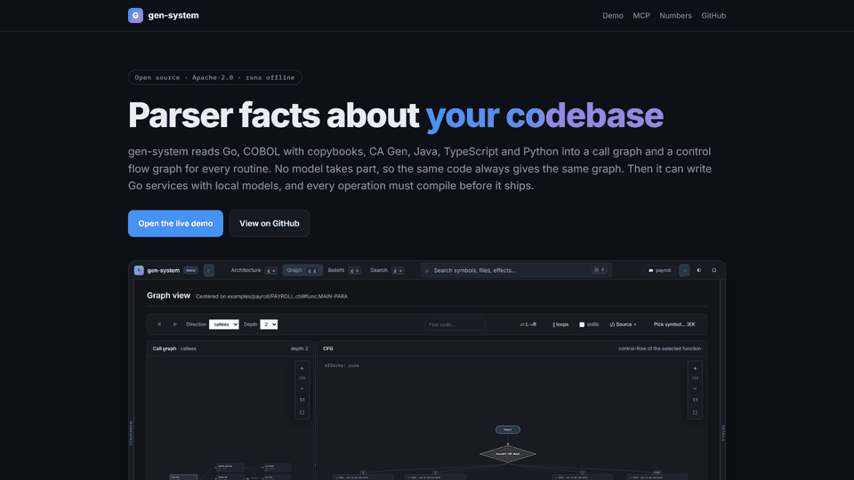

<h1 align="center">gen-system</h1>

<p align="center"><strong>Parser facts about a codebase, for you and for your AI agent.</strong></p>

<p align="center">
  <a href="https://gen-system.500kv.co/"></a>
  <a href="https://github.com/hpdkhoa/gen-system/actions/workflows/ci.yml"></a>
  <a href="LICENSE"></a>
  <a href="go.mod"></a>
  <a href="https://www.npmjs.com/package/gen-understand"></a>
  <a href="https://registry.modelcontextprotocol.io/v0/servers?search=gen-understand"></a>
  <a href="docs/understand-pipeline.md#the-six-parsers"></a>
</p>



*The Studio on [`examples/payroll`](examples/payroll): what `MAIN-PARA` calls, and the control
flow graph of `CALC-TAX`. [Try it in your browser](https://gen-system.500kv.co/demo/), no install.*

## NAME

gen-system: read a codebase with parsers, not a model, and serve the facts to people and agents.

## SYNOPSIS

```
understand-server --root DIR [--copybooks DIRS] [--port 28080] [--stdlib auto|none|LIST]
understand-mcp    --root DIR [--copybooks DIRS] [--allow-corrections] [--no-watch]
gen idea          --out DIR [--style FILE --style-mode gate] "WHAT TO BUILD"
gen style         derive REPO --out FILE | check DIR --profile FILE
genbench          SUBCOMMAND --root DIR [--copybooks DIRS] [--out FILE]
```

## DESCRIPTION

Before you change old code, you need to know what each routine calls, what data it reads and
writes, and how control flows through it. An AI agent needs the same facts, and it guesses them
when nobody gives them.

gen-system reads the code with one hand written parser per language: **Go, COBOL with copybooks,
CA Gen, Java, TypeScript and Python**. From that it builds the symbol index, the call graph and a
control flow graph for each routine. No model takes part, so the same code always gives the same
answer.

For each routine it also lists the inputs, the calls and the data it writes. It calls each line a
*belief*. You can verify or correct any belief, and your correction wins.

You get these facts three ways:

- **the Studio**, a web page to explore the code (`understand-server`);
- **an MCP server**, so Claude Code, Codex or Cursor can ask the same questions (`understand-mcp`);
- **a Go service generator** that uses the facts, with local models through Ollama (`gen`).

The first two read only and contain no model client. A test fails the build if that changes.

## COMMANDS

| Command | What it does |
|---|---|
| `understand-server` | Serves the Studio on http://localhost:28080: architecture, search, call graph, control flow graphs, source, beliefs. |
| `understand-mcp` | The same facts over MCP (stdio). Also on npm as `gen-understand`. |
| `gen-enrich` | Asks a local model to describe each routine. Stores the answers as model claims, which never override the parser. |
| `gen` | `idea` plans and writes a Go service; `continue` and `evolve` change one; `style` measures and checks a team style; `migrate` applies database changes. |
| `gen-server` | The Studio plus generation. |
| `genbench` | Measurements: parse speed, call resolution, control flow checks, model speed, generation. |

## MCP TOOLS

| Tool | Answers |
|---|---|
| `architecture` | languages, top packages, entry points, call resolution, what the parsers could not read |
| `search_symbols` | symbols by name, with the ids the other tools take |
| `call_graph` | callers or callees of a symbol, up to 4 hops |
| `control_flow` | a routine's basic blocks, edges and source lines |
| `source`, `file_symbols` | the code of a symbol; every symbol in a file |
| `effects` | routines grouped by what they touch: database, files, network, pure |
| `beliefs` | the belief records, from the parser, the model or a person |

`correct_belief` appears only with `--allow-corrections`. See [docs/mcp.md](docs/mcp.md).

## INSTALL

```bash
git clone https://github.com/hpdkhoa/gen-system.git && cd gen-system
./install.sh --understand   # only understand-server, for an air gapped review
./install.sh                # everything: also Ollama, two 14B models, one 16 GB GPU
```

For the MCP server alone, you need nothing but Node or Go:

```bash
claude mcp add gen-understand -- npx -y gen-understand --root ./your-repo
go install github.com/hpdkhoa/gen-system/generator/cmd/understand-mcp@latest
```

## EXAMPLES

Explore a repository in the browser:

```bash
understand-server --root ./your-repo
understand-server --root examples/payroll --copybooks examples/payroll/copybooks
```

Ask your agent "who calls CALC-TAX, and which paragraphs touch the database?" on
`examples/payroll`. It calls `call_graph` and `effects`, and gets (shortened):

```jsonc
"edges":     [ { "from": "…#func:PROCESS-EMPLOYEE", "to_name": "CALC-TAX" },
               { "from": "…#func:MAIN-PARA",        "to_name": "PROCESS-EMPLOYEE" } ]
"by_effect": { "db":   [ { "name": "RECORD-RUN", "line": 78 } ],
               "pure": [ { "name": "CALC-GROSS" }, { "name": "CALC-TAX" } ] }
```

Generate a service that follows your team's style:

```bash
gen style derive ~/code/team-repo --out gen-style.json
gen idea --out ./app --style gen-style.json --style-mode gate "a library with members, books and loans"
```

Each operation must compile on its own. One that still fails after two repairs becomes a
`not implemented` stub, and the run counts it. Then `go vet`, `go build` and `go test` run on the
whole service.

## ENVIRONMENT

| Variable | Meaning |
|---|---|
| `GEN_COBOL_COPYBOOK_PATH` | where the COBOL parser looks for copybooks |
| `GEN_STDLIB` | standard library roots, as for `--stdlib` |
| `OLLAMA_HOST` | the Ollama address, default `http://127.0.0.1:11434` |
| `OLLAMA_MODEL_PLAN`, `OLLAMA_MODEL_CODE` | the planning model (`qwen3:14b`) and the code model (`qwen2.5-coder:14b`) |

`gen-system.env.example` lists the rest. Copy it to `.env`; your shell wins over the file.

## FILES

| Path | Holds |
|---|---|
| `DIR/.gen/beliefs.json` | the beliefs and your corrections; attach it to a bug report |
| `DIR/.gen/ast_cache/` | the parser cache; safe to delete |

## ACCURACY

On four public repositories (405 files, 268 of them COBOL) the parsers report 0 parse errors. In
CobolCraft, a Minecraft server in COBOL, all 4,018 calls between its own programs and paragraphs
resolve. GnuCOBOL's compiler agrees with gen-system on all 4,132 `CALL` and `PERFORM` sites, and CI
checks that on every push. In three Go repositories, 98.0% to 99.9% of internal calls resolve.
[docs/results.md](docs/results.md) has the method, the limits and a correction to an earlier claim.

## LIMITS

- Six languages. Other files show as unknown, with no symbols.
- COBOL is checked on one free format GnuCOBOL codebase; no numbers yet for IBM Enterprise COBOL.
- Generation writes Go, on one GPU. Body rewriting works for Go and Python only.
- The model's security review warns and never blocks.

## DOCUMENTATION

| Document | Covers |
|---|---|
| [Understand pipeline](docs/understand-pipeline.md) | how a source file becomes a symbol index, a call graph and control flow graphs |
| [Beliefs](docs/beliefs.md) | the belief record, a worked example, corrections and staleness |
| [MCP server](docs/mcp.md) | setup for Claude Code, Codex and Cursor, the flags and every tool |
| [Style gate](docs/style-gate.md) | team style profiles and how generation checks them |
| [Model contact](docs/model-contact.md) | the single path to the model and its settings |
| [Adding a language](docs/adding-a-language.md) | every file a new parser touches, with its tests |
| [Results](docs/results.md) | the measurements, the GnuCOBOL comparison and a correction |
| [Benchmarks](bench/README.md) | the benchmark drivers and how to rerun a campaign |

## CONTRIBUTING

Found code that gen-system reads wrong? Open an issue and attach `.gen/beliefs.json`.
[CONTRIBUTING.md](CONTRIBUTING.md) covers bug reports, setup, tests and pull requests. Everyone
follows the [code of conduct](CODE_OF_CONDUCT.md).

## SECURITY

Report a vulnerability privately, as [SECURITY.md](SECURITY.md) describes, not in a public issue.

## LICENSE

Apache-2.0. See [LICENSE](LICENSE) and [NOTICE](NOTICE). The only external Go dependency is
`github.com/lib/pq` (MIT).
